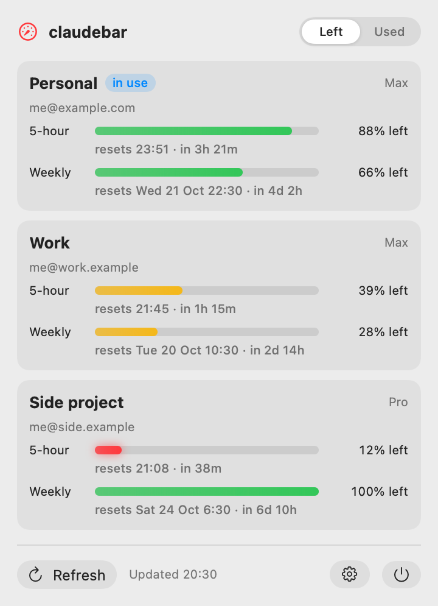
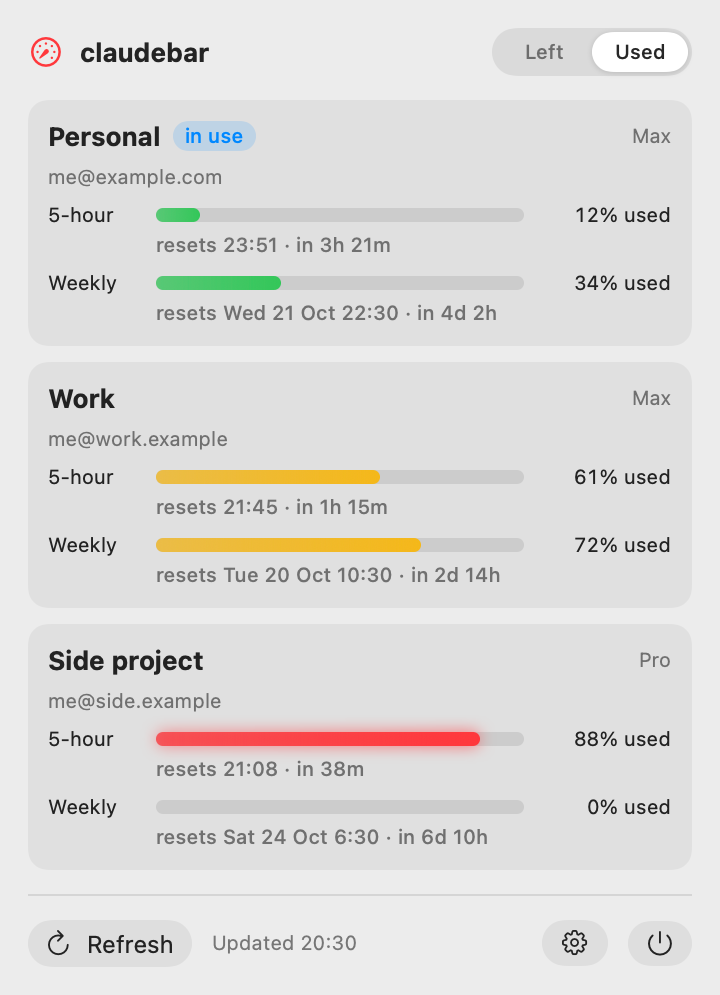
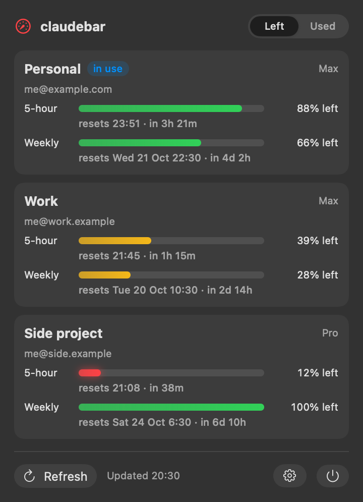

<!-- SPDX-License-Identifier: GPL-3.0-or-later -->
# claudebar

A small macOS menu-bar app (plus a CLI) that shows how much of the **5-hour session** and the **weekly** limit is left on each of your Claude accounts, however many you use with Claude Code. Click the icon to see them all at once; press **Refresh** whenever you like.

<p align="center">
  
</p>

<details>
<summary><b>More screenshots</b> (percent used, dark mode)</summary>

<br>

| Used | Dark |
|:---:|:---:|
|  |  |

</details>

## Left or used

The switch at the top of the menu (also Settings → General) picks how the numbers read:

| Setting | A fresh week shows | The bar fills with |
|---|---|---|
| **Left** (default) | 100% left | what's left, emptying as you go |
| **Used** | 0% used | what's used, filling as you go |

The colours follow what's left whichever way the numbers read:

| Colour | Left | Used |
|---|---|---|
| 🟢 Green | more than 50% | under 50% |
| 🟡 Yellow | more than 20%, up to 50% | 50% up to under 80% |
| 🔴 Red (the bar glows gently) | 20% or less | 80% or more |

The thresholds live in one place, `UsageLevel` in `Sources/UsageKit/Display.swift`, shared by the app and the CLI. The menu-bar gauge's needle follows the lowest "left" across all your accounts, and bounces once each time fresh numbers land.

## How it works

Claude Code already knows these numbers: `claude -p /usage` runs `/usage` as a local command and prints what the interactive screen shows, with no model call (0 tokens, $0). claudebar runs it once per account, each against that account's own Claude Code config folder (`CLAUDE_CONFIG_DIR`), and reads the two lines it needs:

```
Current session: 2% used · resets Sep 24 at 4:49pm (Europe/Madrid)
Current week (all models): 54% used · resets Sep 29 at 2:59am (Europe/Madrid)
```

Per-model weekly lines (Fable and the like) are ignored. `claude auth status --json` adds each account's email and plan, and one more run against your default `~/.claude` marks whichever account a plain `claude` is signed in to as **in use**.

Claude Code keeps each folder's login fresh by itself, so claudebar never reads, stores or refreshes a token. Every probe runs with `--safe-mode` (no hooks, MCP servers or plugins) and `--no-session-persistence` (no session left behind), with auto-update switched off, and without your `ANTHROPIC_*` / `CLAUDE*` environment variables, so an API key or a parent session can't change what it reports. Telemetry is deliberately left as it is: `CLAUDE_CODE_DISABLE_NONESSENTIAL_TRAFFIC` stops `/usage` fetching live numbers, and even `DISABLE_TELEMETRY` changes what it prints. Accounts are probed in parallel, so a refresh takes a few seconds however many there are.

## Requirements

- macOS 14 (Sonoma) or later
- Xcode / Swift toolchain (Swift 5.9+)
- Claude Code. claudebar looks for `claude` in `~/.local/bin`, `/opt/homebrew/bin`, `/usr/local/bin` and `~/.claude/local`; set another path in Settings → General.

## Install

```sh
git clone https://github.com/cjba7/claudebar.git
cd claudebar
make install    # the app into /Applications, the CLI into ~/.local/bin
open /Applications/claudebar.app
```

Then turn on **Launch at login** in Settings → General if you want it there every time. To remove it: `make uninstall`.

## Build

```sh
make app        # build/claudebar.app, signed with kefbar's local identity (or ad hoc)
open build/claudebar.app
make test       # unit tests
```

## Set up your accounts (once)

1. Click the menu-bar icon, then **Settings…** → **Accounts**.
2. Add each account by name (the email is optional and pre-fills the sign-in page). Each gets its own folder, `~/.claude-accounts/<name>`.
3. Press **Sign in…** next to it. Terminal opens on `claude auth login` for that folder; approve in the browser. The browser approves whichever claude.ai account it is signed in to, so switch to the right one there first.
4. Open the menu again: the account's numbers appear.

Your normal `~/.claude` login is untouched; the extra folders exist only so each account stays signed in. You can also work in one directly with `CLAUDE_CONFIG_DIR=~/.claude-accounts/<name> claude`, bearing in mind that folder has its own settings, not the ones in `~/.claude`.

## Configuration

`~/Library/Application Support/claudebar/config.json`. The app writes it, and hand edits are picked up on the next refresh:

```json
{
  "accounts": [
    { "id": "work", "name": "Work", "configDir": "~/.claude-accounts/work", "email": "you@example.com" },
    { "id": "personal", "name": "Personal", "configDir": "~/.claude-accounts/personal" }
  ],
  "show": "left",
  "version": 1
}
```

`configDir` can be any Claude Code config folder; `~/.claude` means your default login (whichever account a plain `claude` is signed in to at the time). `claudePath` is optional. `show` is `"left"` (the default) or `"used"`. `CLAUDEBAR_CONFIG=/path/to/other.json` points the app and CLI at another file.

## CLI

```
claudebar          # every account, human-readable
claudebar --used   # count up (a fresh week is 0% used) for this run
claudebar --left   # count down (a fresh week is 100% left) for this run
claudebar --json   # machine-readable, both numbers; exits 1 if any account had a problem
```

Without `--left` or `--used` the CLI follows the app's setting.

## Caveats

- The numbers come from the text of `/usage`, the only form Claude Code offers them in. If an update rewords those two lines, the account shows "No limits in /usage (…)" until `Sources/UsageKit/UsageParser.swift` is adjusted; `make test` holds a real sample.
- Removing an account in Settings leaves its folder, and the login in it, on disk. To sign it out for good, run `CLAUDE_CONFIG_DIR=~/.claude-accounts/<name> claude auth logout`, then delete the folder.
- `make snapshot` renders the menu to `build/menu.png` for layout work. `make snapshot DEMO=1 [SHOW=used] OUT=docs/images/….png` uses made-up accounts instead of yours; that's how the screenshots above are made.

## License

GPL-3.0-or-later. See [`LICENSE`](LICENSE).
